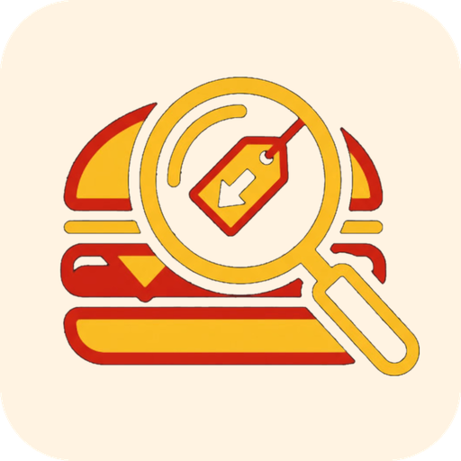
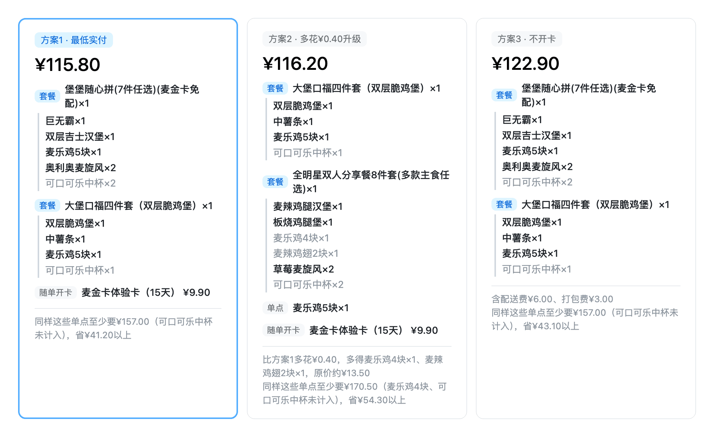

# mcd-deal-detective · 麦侦探



> 去麦当劳之前问一句：我想吃这些，怎么点最省钱？

  

一个 [WorkBuddy](https://www.workbuddy.cn) Skill：说出就餐方式、位置和想吃的东西，它通过麦当劳中国官方 MCP 查实时菜单，穷举所有点法并用官方计价复核，给出最多 3 个方案。**只出方案，不代下单。**

> 本项目为麦当劳程序员节创意开发大赛参赛作品，非麦当劳官方产品。

## 为什么

点麦当劳其实是个组合优化问题：

- 单点、套餐、套餐换选、双人餐，哪种更省？套餐里总带着你不要的东西，换个选项价格又变
- 券、随单开卡、配送费、打包费，都会改变最终实付
- 一个套餐七八个轮次选项，靠心算几乎不可能穷举

麦侦探只解决一件事：**点名的餐品一样不少，整单实付尽量低。** 你说的数量都是下限，多花一点能多得不少的方案会作为升级备选列出。

## 特性

| 能力 | 说明 |
|:--|:--|
| **算法找最优** | 整份加权覆盖搜索，统一比较单点、套餐换选、券、限购、按块数（4块装/5块装）；候选再交给官方 `calculate-price` 复核实付 |
| **支持各渠道的券** | 卡包券自动试价；抖音 / 快手等外购券（券后价 ¥0）会问你当时花了多少，按真实成本参与排序 |
| **外卖 / 到店都行** | 麦乐送按地址找配送门店、配送打包费计入实付；到店取餐自动选最近的营业门店 |

## 示例

**输入**

```text
点个麦乐送到深圳腾大，3个汉堡、2份麦乐鸡、1份薯条、2份麦旋风
```

**输出**

**🕵️ 麦侦探 · 麦当劳深圳腾大餐厅 · 麦乐送（送到深圳腾大）**

🔍 **侦查过程**：翻了本店全部菜单；拆开 29 个套餐/随心配/双人餐看全部可选项；领了 5 张免费券，本店本单暂无可用券；分别按「不开卡」和「随单开麦金卡体验卡（15天）」算；用加权覆盖比较单点、套餐换选和券，共计算 17080 个状态转移；挑出 10 个候选向麦当劳官方核价（10 个有效）。

加粗是你点名要的，灰色是套餐附带多送的。



💡 **结论**：只点你要的、全按最便宜的单点买要 ¥153.25；最省的方案 ¥115.80，少花 **¥37.45**。

## 在 WorkBuddy 里使用

**1. 连接麦当劳 MCP**：在 [麦当劳 MCP 开放平台](https://open.mcd.cn/mcp) 申请 Token，到 WorkBuddy 连接器添加自定义 MCP，把 `${MCD_MCP_TOKEN}` 换成你的 Token：

```json
{
  "mcpServers": {
    "mcd-mcp": {
      "type": "streamablehttp",
      "url": "https://mcp.mcd.cn",
      "headers": {
        "Authorization": "Bearer ${MCD_MCP_TOKEN}"
      }
    }
  }
}
```

**2. 安装 Skill**：在 WorkBuddy 左侧「技能」里搜索「麦侦探」，一键安装即可。

**3. 直接说需求**

```text
深圳腾大附近的麦当劳，到店取餐，2个汉堡、几块麦乐鸡、2块鸡翅、一份薯条，怎么点最划算？
```

没说就餐方式或位置时，它会先问你一句。

## Tips

- **先囤券**：用之前强烈建议先去抖音 / 快手把「看上去」划算的套餐券买下来——不核销会自动退，等于零成本。麦侦探会把外购券按真实成本算进方案，手里有券才比得出来。
- **路上就用**：算法要穷举上千上万种组合，加上模型思考时间，生成一次方案大约需要十分钟。建议出门去餐厅的路上就发起，到店正好拿到结果。

## 许可证

[MIT](LICENSE)
